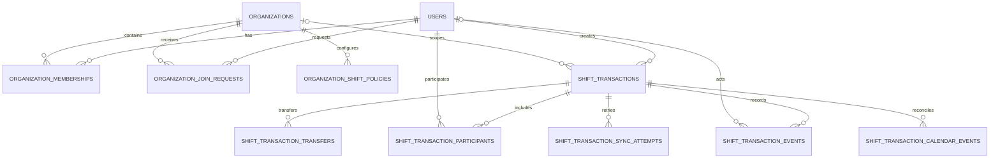

# Backend Database Schema

**Source of truth:** `backend/database/migrations/`  
**Review date:** 2026-11-20

This document summarizes the current Laravel migrations. The migration files, not this document, define the actual schema.

## Application tables

### `users`

- Auto-incrementing integer primary key.
- `name`, unique `email`, nullable `google_subject` (unique), `email_verified_at`, password hash, remember token and timestamps.
- Google subject is hidden from serialized User model output.
- Organization and transaction records reference this table by user ID.

### `organizations`

- UUID primary key.
- Unique slug and display name.
- `created_by_user_id` references `users.id` with restricted deletion.
- Timestamps.

### `organization_memberships`

- Auto-incrementing primary key.
- `organization_id` references organizations with cascade delete.
- `user_id` references users with cascade delete.
- Employee ID, role, status and timestamps.
- Unique organization/user pair and unique organization/employee ID pair.
- Active membership and role checks are enforced in the service/controller layer.

### `organization_join_requests`

- Auto-incrementing primary key.
- Organization and user foreign keys cascade on delete.
- Employee ID, status, approved role, review timestamp and timestamps.
- Unique organization/user pair prevents duplicate requests for the same account.

### `organization_shift_policies`

- Auto-incrementing primary key.
- Organization foreign key cascades on delete.
- Workflow type, approval requirement and timestamps.
- Unique organization/workflow-type pair.

### `shift_transactions`

- UUID string primary key.
- Mode, transaction type, optional organization, creator user ID, status, sync status and optimistic-concurrency version.
- Required idempotency key and SHA-256 request hash.
- JSON metadata and timestamps.
- Creator user foreign key restricts deletion.
- Unique creator/idempotency-key pair.

### `shift_transaction_participants`

- Auto-incrementing primary key.
- Transaction foreign key uses `RESTRICT` on delete.
- User foreign key restricts deletion.
- Employee ID and participant role.
- Unique transaction/user pair; no database unique constraint is defined for participant role.

### `shift_transaction_transfers`

- Auto-incrementing primary key.
- Transaction foreign key uses `RESTRICT` on delete.
- Transfer key, shift ID, from/to employee IDs, shift code, start/end timestamps, purpose, fulfillment timestamp and timestamps.
- Unique transaction/transfer-key pair and unique transaction/shift-ID pair.
- Employee IDs are domain identifiers, not foreign keys to a separate employee table.

### `shift_transaction_sync_attempts`

- UUID primary key and transaction foreign key using `RESTRICT` on delete.
- Per-transaction attempt number with a unique transaction/attempt-number constraint.
- Status (`started`, `completed`, or `failed`), initiating user, optional failure reason, start/finish timestamps and timestamps.
- Supports auditable retries without overwriting previous failed attempts.

### `shift_transaction_calendar_events`

- Auto-incrementing primary key and transaction foreign key using `RESTRICT` on delete.
- One row per transfer key, enforced by a unique transaction/transfer-key constraint.
- Stores provider, optional calendar ID, provider event ID, optional ETag and sync timestamp.
- Legacy completion requests are retained and stored with provider `legacy`; structured requests retain provider-specific references.

### `shift_transaction_events`

- Auto-incrementing primary key.
- Transaction foreign key uses `RESTRICT` on delete.
- Nullable actor user foreign key restricts deletion.
- Event type, transaction version, JSON event data and occurrence timestamp. There is no sequence column.
- Indexes cover transaction/ID, organization/occurrence time and actor/occurrence time; no unique transaction/sequence constraint is defined.
- The service appends event rows during state transitions; append-only behavior is enforced by application flow, not a database trigger. The migration does not define an event sequence column or a uniqueness constraint for event sequence.

## Laravel infrastructure tables

The migrations also define standard framework tables for cache, cache locks, jobs, job batches, failed jobs, sessions and password reset tokens. Their presence does not imply that every configured queue/cache driver is enabled in production.

## Relationship overview

## Integrity and lifecycle rules

- Transaction creation and state transitions use database transactions.
- The service locks transaction rows during transitions and increments a version to prevent stale concurrent updates.
- Idempotency keys are unique per creator; a repeated key with a different request hash is rejected.
- Calendar sync attempts are retained individually; a retry creates a new attempt instead of overwriting a failed attempt.
- Calendar event mappings are unique per transaction transfer leg; completed sync cannot be overwritten by different provider references.
- Foreign-key delete behavior is `RESTRICT` for transaction, participant, transfer and event relationships in the shift-transaction migration. Do not change it without reviewing historical data and authorization implications.
- No production database reset or destructive migration was performed as part of the 2026-11-20 repository work.
- Do not delete user, membership, transaction or event data to make a migration or test pass.

## Migration inventory

Review the exact files under `backend/database/migrations/` before changing the schema. Every schema change must include a migration, feature tests for constraints and relationships, and an explicit rollback/data-preservation assessment.

## Shift Pay configuration tables (additive)

### `user_shift_pay_profiles`

- One row per user, keyed by `user_id` with a restrictive user foreign key.
- Stores mode (`personal`, `organization`, `hybrid`), selected organization ID, hybrid precedence, currency code, decimal precision, personal rule JSON and a monotonically incremented configuration version.
- Organization selection is checked against active membership by the API.

### `organization_shift_pay_profiles`

- One row per organization, with a restrictive organization foreign key.
- Stores organization-owned rule JSON, currency code, decimal precision and configuration version.
- Read access requires active membership; writes require owner/admin role.
- Existing `organization_shift_policies` and their approval semantics remain unchanged.

Both tables are new and additive. Existing users, organizations, policies, shift transactions, participants, transfers and event history are not rewritten. The JSON rule payload is validated against the shared Flutter Shift Pay vocabulary by the API. The tables persist configuration only; no historical payroll snapshot is inferred or backfilled.

### shift_pay_calculation_snapshots

- UUID primary key; references the calculating user and optional selected organization with restricted deletion.
- Stores an idempotency key and request hash unique per user.
- Stores mode, selected source, calculation engine version, personal/organization configuration versions, exact input JSON, selected rule JSON, result JSON and calculation timestamp.
- Has no update timestamp or update endpoint; application flow inserts snapshots and only reads them afterward.
- User/calculation-time and organization/calculation-time indexes support scoped history retrieval.
- Snapshots preserve historical inputs and selected rule data; changing a profile does not rewrite prior results.

## Pending schema additions in open PRs — not deployed on main

The following migrations exist on Draft PR branches only. They are not part of the current main database until the PRs are merged and migrations are explicitly deployed.

### PR #191 — Web Push and notification delivery

- `2026_11_23_000002_create_web_push_subscriptions_table.php`
  - `web_push_subscriptions`: account ownership, unique endpoint hash, public P-256 key, encrypted endpoint/auth material, content encoding, user agent and expiry metadata.
- `2026_11_25_000004_create_notification_outbox_table.php`
  - `notification_outbox`: owner, notification type, idempotency key, JSON payload, status, attempts, availability/claim timestamps, claim token, sent/dead-letter timestamps and last error. Unique owner/idempotency key.
- `2026_11_27_000001_create_notification_deliveries_table.php`
  - `notification_deliveries`: one delivery per outbox/subscription pair, status, attempts, claim token/timestamps, sent/expired timestamps and last error. Unique outbox/subscription pair.

### PR #192 — Canonical Schedule and import journal

- `2026_11_25_000004_create_schedule_records_and_import_journals.php`
  - `schedule_records`: owner, opaque Schedule ID, monotonically increasing generation, live/tombstone state, serialized Schedule payload, fingerprint and deleted-from revision. Unique owner/Schedule ID.
  - `schedule_import_journals`: owner, Schedule ID, import Run ID, lifecycle, base revision, source/accepted fingerprints, JSON provenance and serialized Schedule payload. Unique owner/Run ID/lifecycle with owner/Schedule/time lookup indexes.

### PR #196 — Calendar Sync coordination

- `2026_11_26_000001_create_calendar_sync_coordination.php`
  - `calendar_sync_runs`: owner, Calendar ID, Schedule ID, client instance, status and run timestamps.
  - `calendar_sync_leases`: owner + Calendar ID uniqueness, Run ID, client instance, lease token and expiry/heartbeat timestamps.
  - `calendar_sync_operations`: Run ID, owner, operation key/type/status, payload hash, encrypted payload ciphertext, attempt count, provider event ID and safe error/timing metadata.

**Application-layer encryption added in PR #192:**
- New `schedule_records.schedule_payload` and `schedule_import_journals.schedule_payload` values use a versioned `enc:v1:` Laravel Crypt envelope.
- `schedule_import_journals.provenance` stores an encrypted JSON envelope with `encryption_version` and ciphertext.
- Existing legacy plaintext records remain readable during migration; new writes are encrypted.
- The encryption key is Laravel `APP_KEY`. Back it up and rehearse restore before deployment; losing or rotating the key without re-encryption makes encrypted Schedule/journal data unreadable.
- The encrypted-at-rest change is source-level work in open PR #192; exact-head CI and database acceptance are still required.

**Deployment gate:** no migration in these open PRs has been applied to production by this documentation change. Before deployment, inspect the exact PR migration diffs, run upgrade/rollback tests against a copy of existing data, verify foreign-key and lock semantics on the selected database engine, back up Laravel `APP_KEY`, and rehearse restore. Never reset or replace production data to make a migration pass.

