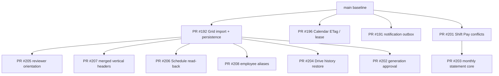

# Pull Request Dependency Map — 2026-11-27

**Audited main:** `68ef85361c2d08e2970160a36475592010d908f7`

## 1. Dependency graph

This graph reflects declared PR stacking and observed base branches, not permission to merge. Recalculate it from live base/head refs before each update.

## 2. Current refs and reconciliation needs

| PR | Base branch | Base SHA reported | Head SHA | Reconciliation |
|---|---|---|---|---|
| #192 | main | `68ef85361c2d08e2970160a36475592010d908f7` | `6663135cff20fab189cdef8996649874ee19a6da` | Reviewer-facing shift suggestions clarified, row-33 fixture anonymized, off-screen checkbox test tap corrected; 12 workflows passed including CAS spike; iOS rerun queued after cancellation, iOS Advisory passed |
| #205 | #192 feature branch | `6663135cff20fab189cdef8996649874ee19a6da` | `8ca446afa41008328df1a39c16f45e955e125c22` | Non-force-pushed merge commit includes current base; compare behind_by=0; Linux/Windows/Web/Dart Format passed; Android/PR Gate/iOS Advisory in progress |
| #207 | #192 feature branch | `6663135cff20fab189cdef8996649874ee19a6da` | `4df59c1523f8d9236ec941fc80fc1918574ca279` | Non-force-pushed merge commit includes current base; compare behind_by=0; Dart Format/Linux/Windows passed; PR Gate/iOS Advisory in progress |
| #206 | #192 feature branch | `6663135cff20fab189cdef8996649874ee19a6da` | `dee3cdca203772ba509da3a359269a09588587e2` | Non-force-pushed merge commit includes current base; compare behind_by=0; Dependency Security/Windows/iOS/Web/Dart/Linux/Android/iOS Advisory passed; PR Gate in progress |
| #208 | #192 feature branch | `6663135cff20fab189cdef8996649874ee19a6da` | `17524ec63d93149c4a5dafb22186e765f4aa979e` | Non-force-pushed merge commit includes current base; compare behind_by=0; Linux/Android passed, Windows/PR Gate/iOS Advisory in progress, remaining checks queued |
| #204 | #192 feature branch | `6663135cff20fab189cdef8996649874ee19a6da` | `3be797eedf46a4ec88ba8cb74c22b2004ba3c344` | Non-force-pushed merge commit includes current base; compare behind_by=0; Linux/Web/Windows passed, Android in progress, remaining checks queued |
| #202 | #192 feature branch | `6663135cff20fab189cdef8996649874ee19a6da` | `cedba990eda4452e92bcc6f23b9e9ef60e4c6a1b` | Non-force-pushed merge commit includes current base; compare behind_by=0; Dependency Security/Dart/Web/Android/Linux/Auto Detect/Windows/Cross-platform/PR Gate passed; iOS/macOS reruns queued after cancellation, iOS Advisory in progress |
| #196 | main | `68ef85361c2d08e2970160a36475592010d908f7` | `fa4dee908848f1bc6919c37dc244ff9eb5b1049f` | Independent mainline slice; recovery rejects terminal success and false-success empty/nonterminal ledgers; exact-head CI partially passed and remains in progress |
| #191 | main | `68ef85361c2d08e2970160a36475592010d908f7` | `cf7eaa22eaf81e04b0b444acfc3aee2a8ca51e5e` | Independent mainline slice |
| #201 | main | `68ef85361c2d08e2970160a36475592010d908f7` | `d3f228dcdaea4f1a3771c271421226ab71ab00b5` | Independent mainline slice |
| #203 | #201 feature branch | `d3f228dcdaea4f1a3771c271421226ab71ab00b5` | `9ddcca51de57b71c721f60665f3c9f8cf0e7bbcb` | Merge/reconcile only after #201 acceptance |

## 3. Safe delivery order

1. Stabilize #192 and record the disposition of its optional/experimental SQLite CAS spike.
2. Reconcile #205 and #207 (parser semantics), then #206 (read-back), #208 (employee alias), #204 (history restore) and #202 (generation approval) against the integrated Grid base. The order may change after diff overlap review.
3. Treat #196 and #191 as separate mainline tracks; do not make them depend on Grid unless actual source changes prove a dependency.
4. Review/merge #201 before #203. Do not infer employment classification requirements from calculation modes.
5. After each merge, refresh main SHA and re-evaluate every stacked PR base, diff, checks and review.

## 4. Merge gate

A PR may be merged only if:
- its base and head are current and the complete diff is understood;
- all required checks for the exact merge candidate have completed successfully;
- no unresolved blocking review threads or changes-requested reviews remain;
- dependencies are already integrated or intentionally included and independently validated;
- tests cover relevant regressions and data-safety boundaries;
- product/security/operational acceptance required for that scope is recorded;
- the PR owner has authorized leaving Draft / merging.

No PR in this inventory is authorized for merge by this audit. All were Draft at inspection.
