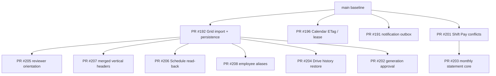

# Pull Request Dependency Map — 2026-11-27

**Audited main:** `68ef85361c2d08e2970160a36475592010d908f7`

## 1. Dependency graph

This graph reflects declared PR stacking and observed base branches, not permission to merge. Recalculate it from live base/head refs before each update.

## 2. Current refs and reconciliation needs

| PR | Base branch | Base SHA reported | Head SHA | Reconciliation |
|---|---|---|---|---|
| #192 | main | `68ef85361c2d08e2970160a36475592010d908f7` | `fb670c84d2ec521f7356342b0147777d6b4f0602` | Mainline base at audit |
| #205 | #192 feature branch | `4d6808d4943236c93a327a079474b0a9915b220a` | `1cfceeeabd3af3f36421f9b06bd286966863b70b` | Base predates current #192 head; reconcile |
| #207 | #192 feature branch | `4d6808d4943236c93a327a079474b0a9915b220a` | `7f6df4380ed60edf436402ca01264eb93dbd416b` | Base predates current #192 head; GitHub reported mergeable=false |
| #206 | #192 feature branch | `4d6808d4943236c93a327a079474b0a9915b220a` | `997c249394bd02c4fd868f4532829e20df9f58fe` | Base predates current #192 head; reconcile |
| #208 | #192 feature branch | `dbcc4fed3bbbf81592b931c3da0f1d9eee68f7aa` | `b98a4e7f7911abe7b97d661bf62c121b1e66d716` | New commit fixes test finder; CI pending at last refresh |
| #204 | #192 feature branch | `4d6808d4943236c93a327a079474b0a9915b220a` | `3fa4b22b74aabaa7d57b391f487d15657f85e2ae` | Base predates current #192 head; reconcile |
| #202 | #192 feature branch | `8d262dc7365a63c279e06affcdedbdbcf1b6fadc` | `ca6ebd095ef6566fcce00e9bc49e9c820470b80d` | Reconcile against current #192 head |
| #196 | main | `68ef85361c2d08e2970160a36475592010d908f7` | `ca0bf5a661c6f6e63d8356a5b198d955635e26c4` | Independent mainline slice |
| #191 | main | `68ef85361c2d08e2970160a36475592010d908f7` | `cf7eaa22eaf81e04b0b444acfc3aee2a8ca51e5e` | Independent mainline slice |
| #201 | main | `68ef85361c2d08e2970160a36475592010d908f7` | `d3f228dcdaea4f1a3771c271421226ab71ab00b5` | Independent mainline slice |
| #203 | #201 feature branch | `d3f228dcdaea4f1a3771c271421226ab71ab00b5` | `9ddcca51de57b71c721f60665f3c9f8cf0e7bbcb` | Merge/reconcile only after #201 acceptance |

## 3. Safe delivery order

1. Stabilize #192 and record the disposition of its optional/experimental SQLite CAS spike.
2. Reconcile #205 and #207 (parser semantics), then #206 (read-back), #208 (employee alias), #204 (history restore) and #202 (generation approval) against the integrated Grid base. The order may change after diff overlap review.
3. Treat #196 and #191 as separate mainline tracks; do not make them depend on Grid unless actual source changes prove a dependency.
4. Review/merge #201 before #203. Do not infer employment classification requirements from calculation modes.
5. After each merge, refresh main SHA and re-evaluate every stacked PR base, diff, checks and review.

## 4. Merge gate

A PR may be merged only if:
- its base and head are current and the complete diff is understood;
- all required checks for the exact merge candidate have completed successfully;
- no unresolved blocking review threads or changes-requested reviews remain;
- dependencies are already integrated or intentionally included and independently validated;
- tests cover relevant regressions and data-safety boundaries;
- product/security/operational acceptance required for that scope is recorded;
- the PR owner has authorized leaving Draft / merging.

No PR in this inventory is authorized for merge by this audit. All were Draft at inspection.
